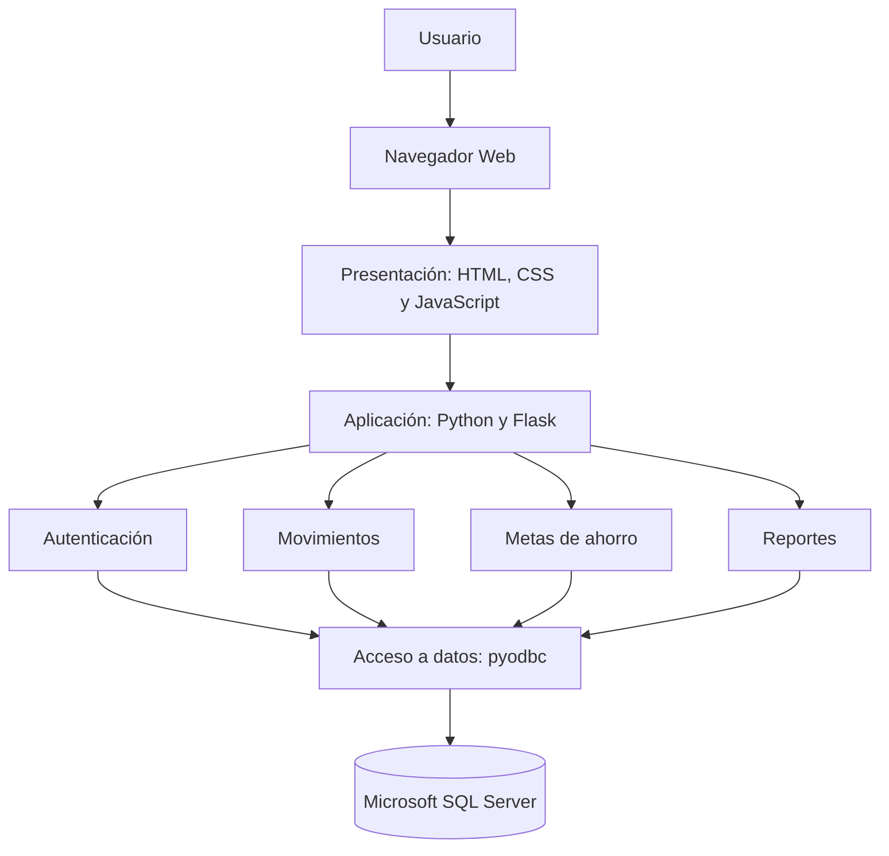

# Arquitectura e Interfaces del Sistema

## Proyecto: MiFinanzas

**Asignatura:** Ingeniería de Software  
**Unidad:** 2. Análisis y Diseño  
**Versión:** v2.0-u2  

---

## 1. Introducción

MiFinanzas es un sistema web de administración
de finanzas personales que permitirá a los usuarios
registrar ingresos, gastos y metas de ahorro.

Este documento presenta la arquitectura propuesta,
el diseño de las interfaces principales y los
contratos de comunicación del sistema.

---

## 2. Patrón Arquitectónico

Para MiFinanzas se propone utilizar una
arquitectura en tres capas:

1. Presentación.
2. Lógica de aplicación.
3. Persistencia de datos.

### 2.1 Capa de Presentación

Se desarrollará utilizando HTML5, CSS3 y JavaScript.

Permitirá visualizar saldos, registrar movimientos,
consultar reportes y administrar metas de ahorro.

La interfaz utilizará colores pastel y un diseño
adaptable a computadoras y dispositivos móviles.

### 2.2 Capa de Aplicación

Se implementará mediante Python y Flask.

Sus responsabilidades serán:

- Gestionar el registro de usuarios.
- Validar las credenciales.
- Controlar sesiones.
- Procesar movimientos financieros.
- Calcular ingresos, gastos y saldos.
- Administrar metas de ahorro.

### 2.3 Capa de Persistencia

Utilizará Microsoft SQL Server para almacenar
la información financiera.

Python se comunicará con SQL Server mediante
la biblioteca pyodbc.

### 2.4 Justificación

La arquitectura en capas facilita la separación
de responsabilidades, la organización del código,
la realización de pruebas y el mantenimiento.

También permite ampliar el sistema con nuevas
funcionalidades sin modificar completamente
su estructura.

---

## 3. Diagrama de Arquitectura



---

## 4. Diseño de Interfaces UI/UX

MiFinanzas contará con una interfaz visual
intuitiva, organizada y adaptable.

Se utilizarán colores pastel para distinguir
las diferentes secciones financieras.

### 4.1 Pantalla de Inicio de Sesión

```text
+--------------------------------------+
|                                      |
|             MiFinanzas               |
|                                      |
|    Control de gastos personales      |
|                                      |
|    Correo electrónico                |
|    +----------------------------+    |
|    |                            |    |
|    +----------------------------+    |
|                                      |
|    Contraseña                        |
|    +----------------------------+    |
|    |                            |    |
|    +----------------------------+    |
|                                      |
|    [      Iniciar sesión       ]     |
|                                      |
|       Crear una cuenta               |
|                                      |
+--------------------------------------+
```

### 4.2 Pantalla de Registro

```text
+--------------------------------------+
|                                      |
|             MiFinanzas               |
|                                      |
|           Crear cuenta               |
|                                      |
|    Nombre completo                   |
|    +----------------------------+    |
|    |                            |    |
|    +----------------------------+    |
|                                      |
|    Correo electrónico                |
|    +----------------------------+    |
|    |                            |    |
|    +----------------------------+    |
|                                      |
|    Contraseña                        |
|    +----------------------------+    |
|    |                            |    |
|    +----------------------------+    |
|                                      |
|    [       Registrarse         ]     |
|                                      |
+--------------------------------------+
```

### 4.3 Panel Principal

```text
+----------------+-----------------------------+
|                |                             |
|   MiFinanzas   |  Bienvenido, usuario        |
|                |                             |
|   Inicio       |  +---------+ +---------+    |
|                |  | Saldo   | | Gastos  |    |
|   Movimientos  |  +---------+ +---------+    |
|                |                             |
|   Registrar    |  +---------------------+    |
|                |  |                     |    |
|   Mis metas    |  | Gráfica de gastos   |    |
|                |  |                     |    |
|   Reportes     |  +---------------------+    |
|                |                             |
|                |  Movimientos recientes      |
|   Salir        |  +---------------------+    |
|                |  | Historial financiero|    |
+----------------+-----------------------------+
```

### 4.4 Registro de Movimiento

```text
+--------------------------------------+
|                                      |
|       Registrar movimiento           |
|                                      |
|    Tipo de movimiento                |
|    [ Ingreso / Gasto ]               |
|                                      |
|    Categoría                         |
|    [ Seleccionar categoría ]         |
|                                      |
|    Descripción                       |
|    [________________________]        |
|                                      |
|    Monto                             |
|    [________________________]        |
|                                      |
|    Fecha                             |
|    [________________________]        |
|                                      |
|    [ Cancelar ] [ Guardar ]          |
|                                      |
+--------------------------------------+
```

---

## 5. Contratos de Interfaz y API REST

Se propone una API REST para facilitar
la comunicación entre el frontend y
el backend de MiFinanzas.

Los siguientes endpoints representan
el diseño propuesto y no necesariamente
rutas implementadas actualmente.

| Método | Endpoint | Función |
|---|---|---|
| POST | /api/usuarios | Registrar usuario |
| POST | /api/auth/login | Iniciar sesión |
| POST | /api/auth/logout | Cerrar sesión |
| GET | /api/movimientos | Consultar movimientos |
| POST | /api/movimientos | Registrar movimiento |
| PUT | /api/movimientos/{id} | Actualizar movimiento |
| DELETE | /api/movimientos/{id} | Eliminar movimiento |
| GET | /api/categorias | Consultar categorías |
| GET | /api/resumen | Consultar resumen financiero |
| GET | /api/metas | Consultar metas |
| POST | /api/metas | Crear meta de ahorro |

### 5.1 Ejemplo de Registro de Movimiento

**Método:** POST

**Endpoint:** /api/movimientos

**Solicitud JSON:**

```json
{
    "tipo": "Gasto",
    "categoria_id": 1,
    "descripcion": "Compra de alimentos",
    "monto": 250.00,
    "fecha": "2026-11-11"
}
```

**Respuesta esperada:**

```json
{
    "mensaje": "Movimiento registrado",
    "id_movimiento": 1
}
```

**Código HTTP:** 201 Created.

El identificador del usuario deberá obtenerse
de la sesión autenticada, sin confiar en un
identificador enviado por el cliente.

### 5.2 Manejo de Errores

La API deberá contemplar las siguientes respuestas:

| Código HTTP | Significado |
|---|---|
| 200 | Operación exitosa |
| 201 | Recurso creado |
| 400 | Datos incorrectos |
| 401 | Usuario no autenticado |
| 403 | Acceso no autorizado |
| 404 | Recurso no encontrado |
| 409 | Conflicto de datos |
| 500 | Error interno del servidor |

### 5.3 Seguridad de los Endpoints

Los endpoints que administren información
financiera deberán requerir autenticación.

El sistema deberá validar los datos recibidos,
proteger las sesiones y verificar que los
recursos consultados pertenezcan al usuario.

Las operaciones que modifiquen información
deberán incorporar mecanismos de protección
contra solicitudes no autorizadas.

---

## 6. Relación con los Requisitos

| Requisito | Interfaz o endpoint propuesto |
|---|---|
| RF-01 | Registro / POST /api/usuarios |
| RF-02 | Login / POST /api/auth/login |
| RF-03 | Movimientos / POST /api/movimientos |
| RF-04 | Movimientos / POST /api/movimientos |
| RF-05 | Historial / PUT y DELETE /api/movimientos/{id} |
| RF-06 | Categorías / GET /api/categorias |
| RF-07 | Dashboard / GET /api/resumen |
| RF-08 | Historial / GET /api/movimientos |
| RF-09 | Administración de usuarios, pendiente de diseño detallado |

---

## 7. Conclusión

El diseño de arquitectura e interfaces de
MiFinanzas establece una estructura organizada
para el desarrollo del sistema.

La arquitectura en capas permite separar la
interfaz visual, las operaciones de negocio
y el almacenamiento de información.

Los wireframes representan la distribución
de las pantallas principales, mientras que
los contratos de API describen las operaciones
previstas para la comunicación del sistema.

Estos elementos servirán como referencia
para continuar con la implementación,
integración y pruebas de MiFinanzas.
