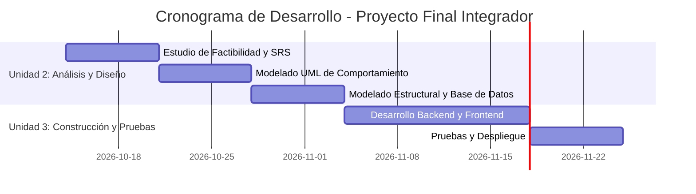

# Estudio de Factibilidad y Planificación del Proyecto

## 1. Análisis de Factibilidad Multidimensional

### 1.1 Factibilidad Técnica

El proyecto consiste en desarrollar un Sistema de Control de Gastos Personales que permita registrar ingresos y gastos, organizarlos por categorías y consultar información para llevar un mejor control del dinero.

Para desarrollar el sistema se propone utilizar **Python** como lenguaje de programación, ya que permite implementar la lógica del sistema y procesar la información. Para almacenar y administrar los datos se utilizará **MySQL**, un gestor de bases de datos que hemos trabajado anteriormente y que nos permitirá organizar la información de los usuarios, ingresos, gastos y categorías.

También utilizaremos **Git y GitHub** para administrar los cambios, trabajar mediante ramas y mantener organizadas las aportaciones de los integrantes del equipo.

Estas herramientas se consideran adecuadas porque nos permiten aprovechar los conocimientos que ya tenemos y aplicarlos al desarrollo del proyecto. Aunque todavía será necesario implementar y probar las diferentes funciones del sistema, contamos con una base que nos ayudará a avanzar de manera gradual.

Por lo tanto, la factibilidad técnica se considera favorable, ya que las herramientas seleccionadas son adecuadas para las necesidades del proyecto y el equipo cuenta con conocimientos previos para comenzar su desarrollo.

### 1.2 Factibilidad Económica

Para desarrollar el Sistema de Control de Gastos Personales se buscará aprovechar las herramientas gratuitas y los equipos de cómputo disponibles para los integrantes del equipo, con el objetivo de reducir los gastos durante el desarrollo.

Los principales costos que podrían presentarse son el alojamiento del sistema, el almacenamiento de la base de datos y el uso de servicios externos o APIs, en caso de que sean necesarios. Por el momento, se buscará trabajar con herramientas gratuitas para evitar gastos adicionales.

De acuerdo con la guía de prácticas, se cuenta con un total de **9 horas prácticas** para realizar las actividades correspondientes a las semanas 6, 7 y 8. Durante este tiempo se trabajará en el análisis, la planificación y los entregables solicitados, distribuyendo las actividades entre los tres integrantes del equipo.

El costo de las horas-hombre se puede calcular multiplicando las horas dedicadas al proyecto por un costo establecido por hora. Como se trata de un proyecto académico, no se asignará un costo monetario al trabajo de los integrantes, pero sí se considerará el tiempo invertido como un recurso importante.

Por estas razones, el proyecto se considera económicamente viable para fines académicos, ya que se puede comenzar con las herramientas disponibles y evaluar posibles gastos adicionales conforme avance el desarrollo.

### 1.3 Factibilidad Operativa

El sistema estará dirigido a personas que deseen llevar un mejor control de sus ingresos y gastos. Por ello, se buscará que la interfaz sea sencilla, clara y fácil de utilizar, para que los usuarios puedan registrar sus movimientos y consultar su información sin dificultades.

Para facilitar su uso, se pretende organizar los gastos por categorías, mostrar resúmenes de los movimientos y realizar pruebas que permitan identificar errores o partes del sistema que puedan resultar confusas.

También será importante proteger la información personal y financiera que se registre. Para ello, se deberán considerar medidas como limitar el acceso a los datos, proteger las credenciales y evitar que personas no autorizadas puedan consultar la información. Asimismo, se tendrá en cuenta la Ley Federal de Protección de Datos Personales en Posesión de los Particulares (LFPDPPP), cuando resulte aplicable.

La posible resistencia al cambio se puede reducir mediante una interfaz intuitiva, instrucciones claras y pruebas con usuarios. Por estas razones, se considera que el proyecto tiene una factibilidad operativa favorable, siempre que se atiendan las necesidades de los usuarios y se proteja adecuadamente su información.

## 2. Cronograma de Trabajo y Diagrama de Gantt

El siguiente cronograma muestra las actividades principales del proyecto y el tiempo estimado para cada una, de acuerdo con la planificación indicada en la guía de prácticas.

El cronograma permite organizar las actividades y visualizar las etapas de análisis, diseño, construcción y pruebas. Las fechas podrán ajustarse si se presentan cambios en los requerimientos o en el avance del equipo.

## 3. Matriz de Asignación de Responsabilidades (RACI)

La matriz RACI permite organizar las responsabilidades de los integrantes del equipo y establecer quién realiza cada actividad, quién responde por su cumplimiento, a quién se consulta y quién debe mantenerse informado.

**Significado de las letras:**

- **R (Responsible):** realiza la actividad.
- **A (Accountable):** responde por que la actividad se complete correctamente.
- **C (Consulted):** participa mediante consultas u opiniones.
- **I (Informed):** recibe información sobre el avance o resultado.

| Tarea / Entregable | Sandra Martinez Salinas | Yasmin Guadalupe Quintana Rojas | Melissa Midori Quintana Mendoza |
| :--- | :---: | :---: | :---: |
| Estudio de Factibilidad | A/R | C | I |
| Redacción del SRS IEEE 830 | A | R | C |
| Diagramación UML | C | A | R |
| Diseño de Base de Datos | I | C | A/R |
| Revisión de entregables | A | R | C |
| Seguimiento de actividades | R | A | C |

La distribución se propone tomando en cuenta los roles del equipo: Sandra como Product Owner, Yasmin como Scrum Master y Melissa como desarrolladora. Los tres integrantes podrán apoyarse entre sí cuando sea necesario para cumplir con las actividades.

## 4. Conclusión

Con este análisis podemos identificar que el Sistema de Control de Gastos Personales es viable para desarrollarse como proyecto académico, ya que contamos con conocimientos previos y herramientas que nos permiten comenzar sin realizar una inversión inicial elevada. También comprendimos que es importante organizar las actividades, distribuir las responsabilidades y considerar la seguridad de la información desde el inicio. El cronograma y la matriz RACI nos ayudarán a coordinarnos mejor y a tener más claro qué debemos realizar para avanzar con el proyecto.