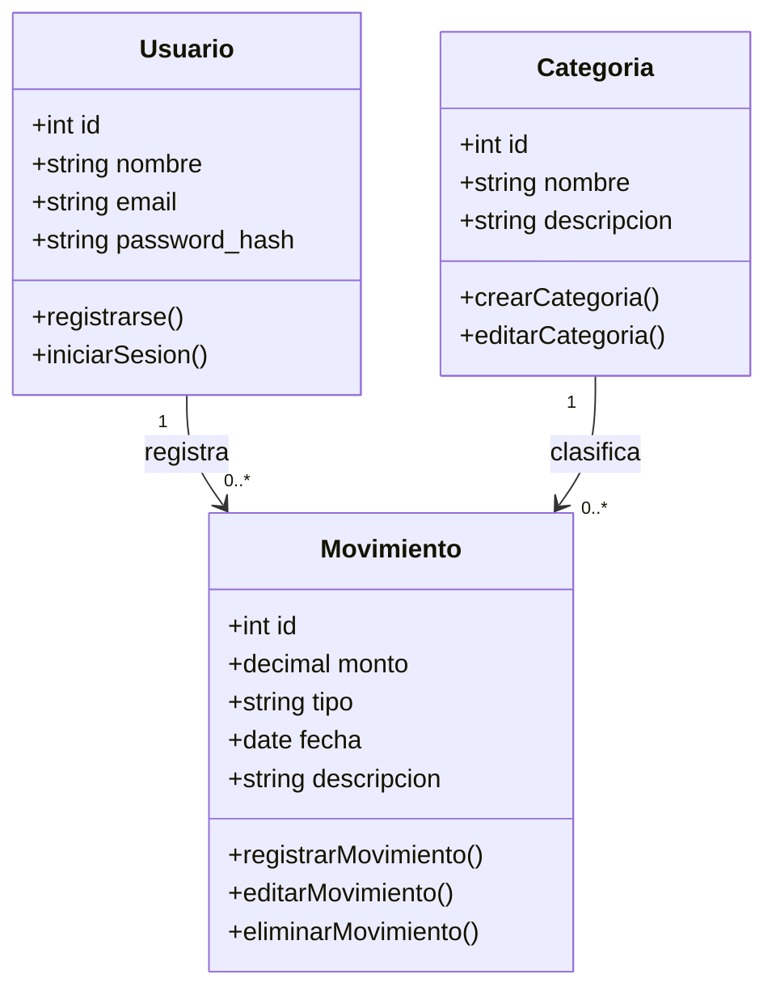
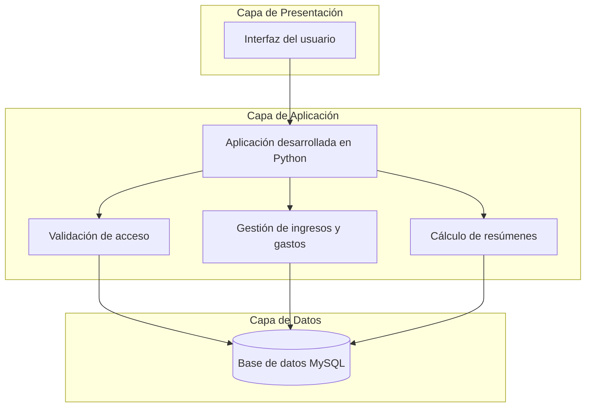

# Modelado Estructural y Diagramas de Arquitectura UML

## 1. Introducción

En esta parte del proyecto vamos a representar cómo estará organizado nuestro Sistema de Control de Gastos Personales. Para ello, utilizaremos diagramas UML que nos ayuden a identificar las clases principales, la relación entre ellas y la forma en que se comunicarán las partes del sistema.

También diseñaremos la estructura de la base de datos que utilizaremos para guardar la información de los usuarios, sus categorías y sus movimientos económicos.

## 2. Diagrama de Clases UML

El diagrama de clases muestra los elementos principales que tendrá nuestro sistema y la relación que existe entre ellos.

Consideramos tres clases principales: Usuario, Categoria y Movimiento. El usuario podrá registrar sus ingresos y gastos, organizarlos por categorías y consultar sus movimientos.

### 2.1 Descripción de las clases

- **Usuario:** contiene los datos necesarios para identificar a la persona que utiliza el sistema.
- **Categoria:** permite organizar los movimientos, por ejemplo, en alimentación, transporte, vivienda o entretenimiento.
- **Movimiento:** almacena la información de cada ingreso o gasto, incluyendo el importe, el tipo, la fecha y la descripción.

Un usuario podrá registrar varios movimientos y cada movimiento estará relacionado con una categoría. De esta manera, será más fácil consultar y organizar la información financiera.

## 3. Diagrama de Componentes y Arquitectura

Este diagrama representa cómo se organizarán las partes principales del sistema y cómo se comunicarán entre sí.

Para nuestro proyecto consideramos una interfaz para el usuario, un módulo desarrollado en Python que procesará las operaciones y una base de datos MySQL donde se almacenará la información.

### 3.1 Descripción de la arquitectura

- **Capa de presentación:** será la parte con la que interactuará el usuario para ingresar información y consultar sus movimientos.
- **Capa de aplicación:** contendrá la lógica desarrollada en Python para validar los datos, registrar ingresos y gastos y calcular los resúmenes.
- **Capa de datos:** estará formada por MySQL, donde se guardarán los usuarios, las categorías y los movimientos registrados.

Esta organización nos permitirá separar las responsabilidades de cada parte y facilitar los cambios que se necesiten durante el desarrollo.

## 4. Relación con la Base de Datos

El diseño de la base de datos estará relacionado con las clases del diagrama UML. Cada usuario podrá tener varios movimientos y cada movimiento estará asociado con una categoría.

Las tablas principales serán:

- **usuarios:** guardará los datos de las cuentas registradas.
- **categorias:** almacenará las categorías disponibles para clasificar los movimientos.
- **movimientos:** guardará los ingresos y gastos de los usuarios.

Las relaciones entre estas tablas ayudarán a mantener organizada la información y permitirán consultar los movimientos de cada usuario.

## 5. Conclusión

Con estos diagramas podemos tener una idea más clara de cómo estará organizado nuestro Sistema de Control de Gastos Personales. El diagrama de clases nos permite identificar los elementos principales y sus relaciones, mientras que el diagrama de arquitectura muestra cómo se distribuirán las funciones entre la aplicación y la base de datos.

Este diseño nos servirá como guía para crear las tablas en MySQL y continuar con el desarrollo del sistema utilizando Python.
