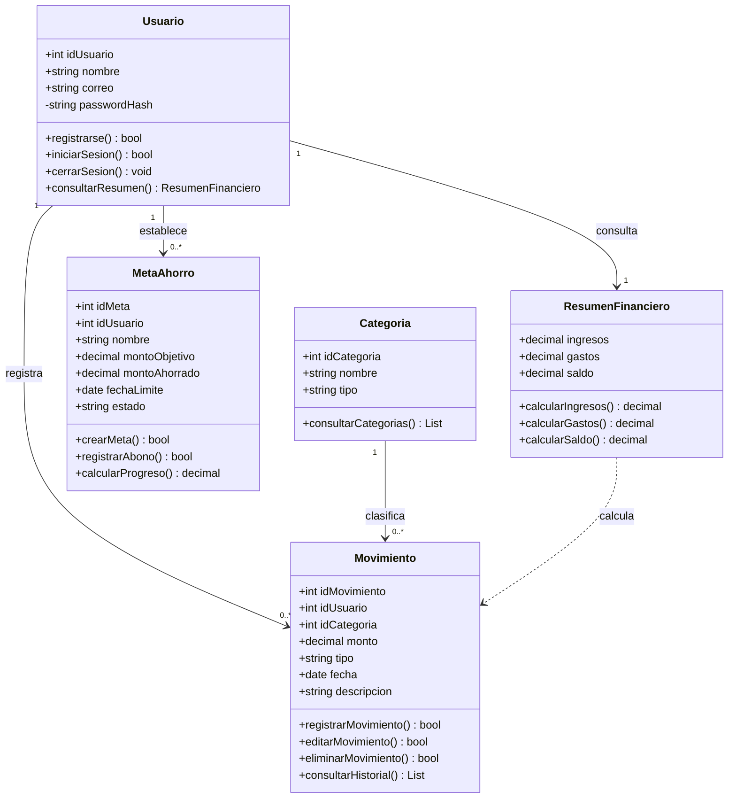
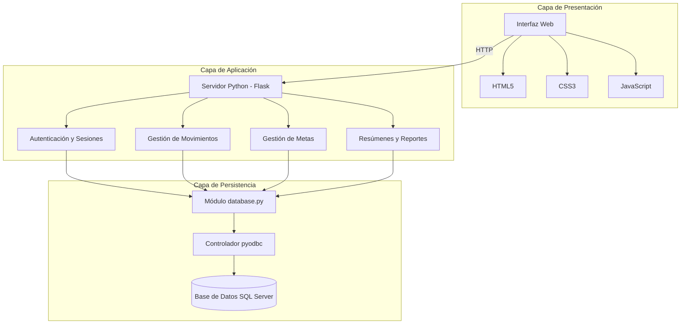
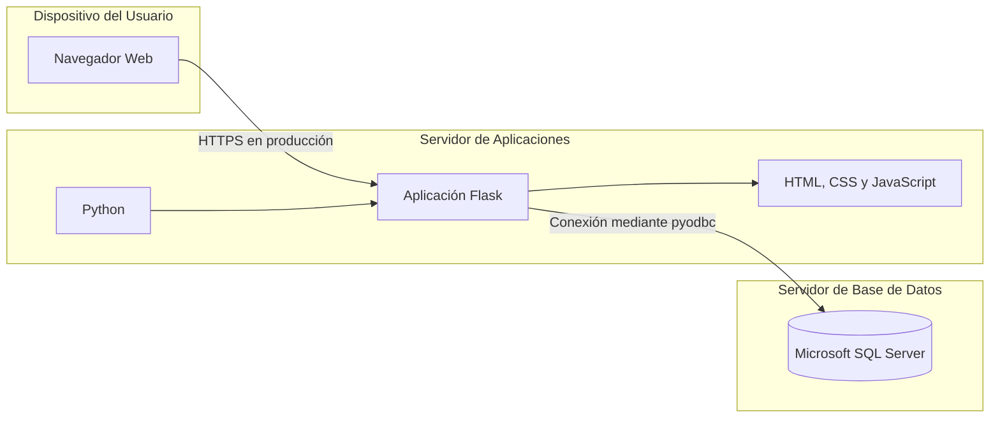
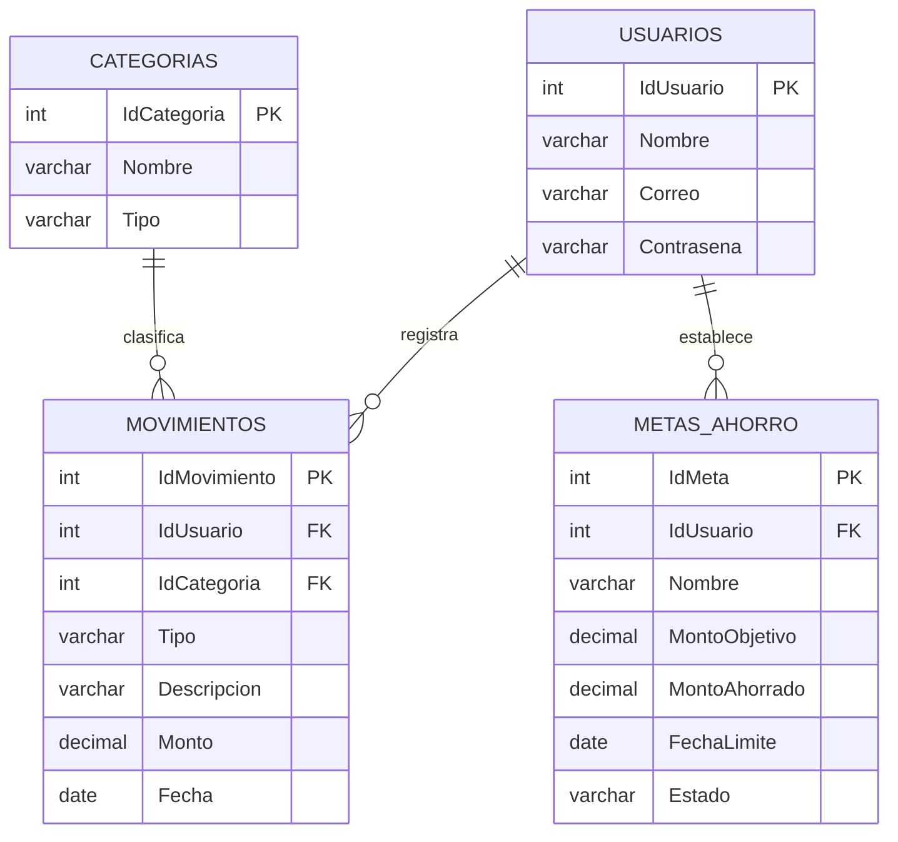

# Modelado Estructural y Diagramas de Arquitectura UML

## Proyecto: MiFinanzas
### Sistema Web de Control de Gastos Personales

**Asignatura:** Ingeniería de Software  
**Unidad:** 2. Análisis y Diseño  
**Práctica:** 10. Integración del Portafolio de Análisis y Diseño  
**Versión:** v2.0-u2  

---

## 1. Introducción

El presente documento describe el modelado estructural y
la arquitectura propuesta para MiFinanzas, un sistema web
de control de gastos personales.

El propósito del modelado es representar la organización
interna del sistema, identificar las clases principales,
establecer las relaciones entre sus componentes y
definir la estructura de almacenamiento de los datos.

Para el desarrollo se contempla utilizar Python y Flask
en la lógica de aplicación, HTML5, CSS3 y JavaScript en
la interfaz de usuario, y Microsoft SQL Server como
gestor de base de datos relacional.

El sistema permitirá que diferentes usuarios administren
sus ingresos, gastos, categorías y metas de ahorro,
manteniendo su información financiera separada.

Los diagramas se elaboran utilizando Mermaid para
facilitar su visualización y mantenimiento dentro
del repositorio de GitHub.

---

## 2. Diagrama de Clases UML

El diagrama de clases representa las entidades principales
de MiFinanzas, sus atributos, operaciones y relaciones.

Se consideran cinco clases conceptuales:

- Usuario
- Categoria
- Movimiento
- MetaAhorro
- ResumenFinanciero

Las primeras cuatro representan información persistente
del sistema. ResumenFinanciero representa un resultado
calculado a partir de los movimientos registrados.

### 2.1 Diagrama de clases

### 2.2 Descripción de las clases

#### Clase Usuario

Representa a cada persona que utiliza MiFinanzas.

Sus atributos permiten identificar al usuario y
almacenar la información necesaria para autenticarlo.

La contraseña no deberá almacenarse en texto plano,
sino mediante un hash seguro.

**Responsabilidades:**

- Registrar una cuenta.
- Iniciar sesión mediante credenciales.
- Cerrar sesión.
- Consultar su resumen financiero.

**Relaciones:**

Un usuario puede registrar cero o muchos movimientos
y establecer cero o muchas metas de ahorro.

#### Clase Categoria

Permite clasificar los movimientos financieros
para facilitar su organización y análisis.

Entre las categorías consideradas se encuentran
alimentación, transporte, vivienda, entretenimiento
y trabajo.

**Responsabilidades:**

- Identificar la categoría de un movimiento.
- Distinguir categorías de ingresos y gastos.
- Permitir consultar las categorías disponibles.

Cada categoría puede estar relacionada con
múltiples movimientos.

#### Clase Movimiento

Representa cada ingreso o gasto que registra
un usuario dentro del sistema.

**Atributos principales:**

- Identificador del movimiento.
- Identificador del usuario.
- Identificador de categoría.
- Monto.
- Tipo de movimiento.
- Fecha.
- Descripción.

**Responsabilidades:**

- Registrar ingresos y gastos.
- Consultar movimientos.
- Editar registros existentes.
- Eliminar movimientos.
- Consultar el historial financiero.

Las operaciones de edición y eliminación forman
parte del diseño funcional propuesto y deberán
validarse durante la implementación.

#### Clase MetaAhorro

Representa los objetivos financieros establecidos
por los usuarios.

Por ejemplo, ahorrar para un viaje, comprar una
computadora o reunir un fondo de emergencia.

**Responsabilidades:**

- Crear metas de ahorro.
- Registrar avances.
- Consultar el monto ahorrado.
- Calcular el porcentaje de progreso.
- Determinar si una meta ha sido completada.

Cada meta pertenece a un usuario específico.

#### Clase ResumenFinanciero

Representa los resultados obtenidos a partir
de los movimientos financieros.

**Responsabilidades:**

- Calcular el total de ingresos.
- Calcular el total de gastos.
- Determinar el saldo disponible.
- Proporcionar datos para gráficas y reportes.

El saldo se calcula mediante la expresión:

Saldo = Total de ingresos - Total de gastos

Esta clase es conceptual y no requiere necesariamente
una tabla independiente en la base de datos.

---

## 3. Diagrama de Componentes y Arquitectura

MiFinanzas utiliza una arquitectura lógica en capas,
separando la presentación, el procesamiento de
operaciones y el almacenamiento de información.

Esta separación facilita el mantenimiento del sistema
y permite modificar una parte sin afectar
innecesariamente a las demás.

### 3.1 Diagrama de componentes

### 3.2 Capa de presentación

Es la parte del sistema con la que interactúan
directamente los usuarios.

Está formada por las páginas HTML, los estilos CSS
y las funciones JavaScript.

Permite:

- Iniciar sesión.
- Registrar usuarios.
- Registrar movimientos financieros.
- Consultar saldos y gastos.
- Visualizar gráficas.
- Administrar metas de ahorro.

El diseño visual utiliza colores pastel,
tarjetas informativas y navegación lateral
para facilitar la interacción.

### 3.3 Capa de aplicación

Se desarrolla utilizando Python y Flask.

Se encarga de recibir las solicitudes del
navegador, ejecutar las validaciones y
procesar las operaciones del sistema.

Sus responsabilidades incluyen:

- Autenticar usuarios.
- Gestionar sesiones.
- Validar formularios.
- Procesar ingresos y gastos.
- Calcular saldos.
- Gestionar metas.
- Obtener información para reportes.

Flask comunica la interfaz con la capa
de persistencia.

### 3.4 Capa de persistencia

La capa de persistencia administra el
almacenamiento de datos en Microsoft SQL Server.

La conexión desde Python se realiza mediante
el módulo database.py y la biblioteca pyodbc.

En esta capa se almacenan los registros
de usuarios, categorías, movimientos y
metas de ahorro.

El sistema deberá aplicar restricciones
de integridad referencial y consultas
parametrizadas para proteger los datos.

---

## 4. Diagrama de Despliegue

El diagrama de despliegue muestra cómo se
distribuirán los componentes del sistema
en los dispositivos y servidores.

Durante el desarrollo, la aplicación Flask
y SQL Server pueden ejecutarse en un entorno local.

Para una implementación multiusuario se propone
una arquitectura cliente-servidor.

### 4.1 Diagrama de despliegue

### 4.2 Descripción del despliegue

**Dispositivo del usuario**

Permite acceder a MiFinanzas mediante un navegador
web desde una computadora o dispositivo móvil.

**Servidor de aplicaciones**

Ejecuta Python y Flask, recibe solicitudes,
procesa las operaciones y genera respuestas.

**Servidor de base de datos**

Almacena los datos de los usuarios y sus
registros financieros.

### 4.3 Consideraciones de implementación

Actualmente se contempla un entorno local
de desarrollo.

Para permitir el acceso desde diferentes
dispositivos será necesario configurar
un servidor accesible en red.

También deberán establecerse conexiones
seguras mediante HTTPS, proteger las
credenciales y configurar adecuadamente
el entorno de producción.

El diagrama representa una propuesta de
despliegue y no una implementación pública
que ya se encuentre disponible.

---

## 5. Relación con la Base de Datos

El modelo de datos se deriva de las entidades
identificadas durante el análisis.

MiFinanzas contempla cuatro tablas principales:

- Usuarios
- Categorias
- Movimientos
- MetasAhorro

Estas tablas almacenarán la información necesaria
para implementar las funciones del sistema.

### 5.1 Diagrama Entidad-Relación

### 5.2 Descripción de las entidades

#### Tabla Usuarios

Almacena los datos necesarios para
identificar y autenticar a cada usuario.

El campo IdUsuario representa la clave primaria.

El campo Correo deberá identificar de manera
única cada cuenta.

#### Tabla Categorias

Contiene las categorías utilizadas para
clasificar los movimientos.

IdCategoria es la clave primaria.

El campo Tipo permite distinguir categorías
de ingresos y gastos.

#### Tabla Movimientos

Almacena los ingresos y gastos registrados.

IdMovimiento identifica cada movimiento.

IdUsuario relaciona el movimiento con su
propietario.

IdCategoria relaciona el movimiento con
la categoría correspondiente.

#### Tabla MetasAhorro

Almacena los objetivos de ahorro definidos
por cada usuario.

IdMeta identifica cada meta.

IdUsuario permite relacionar cada objetivo
con la cuenta que lo creó.

### 5.3 Integridad referencial

Las relaciones entre tablas se establecen
mediante claves primarias y foráneas.

Cada movimiento deberá estar asociado a
un usuario válido.

Cada movimiento deberá relacionarse con
una categoría existente.

Cada meta de ahorro deberá pertenecer a
un usuario registrado.

Estas relaciones permiten mantener la
consistencia de la información.

### 5.4 Esquema SQL

El script de creación de tablas se documenta
en el archivo:

[Consultar esquema de base de datos](database/schema.sql)

El script deberá corresponder con la versión
de SQL Server utilizada en MiFinanzas.

---

## 6. Matriz de Trazabilidad Requisito-Diseño

La matriz de trazabilidad relaciona los
requerimientos funcionales definidos en
SRS_IEEE830.md con los componentes y
entidades del diseño.

Esta relación permite comprobar que
las funcionalidades solicitadas tengan
una representación dentro de la arquitectura.

| Requisito | Descripción | Componente o clase | Entidad de datos |
|---|---|---|---|
| RF-01 | Registro de usuarios | Usuario y Autenticación | Usuarios |
| RF-02 | Inicio de sesión | Usuario y Autenticación | Usuarios |
| RF-03 | Registrar ingresos | Movimiento | Movimientos |
| RF-04 | Registrar gastos | Movimiento | Movimientos |
| RF-05 | Administrar movimientos | Movimiento | Movimientos |
| RF-06 | Organizar categorías | Categoria | Categorias |
| RF-07 | Consultar resumen | ResumenFinanciero | Movimientos |
| RF-08 | Consultar historial | Movimiento | Movimientos |
| RF-09 | Administrar usuarios | Administración de usuarios propuesta | Usuarios |

### 6.1 Relación con los casos de uso

Cada requisito funcional se relaciona con
un caso de uso del sistema.

| Requisito | Caso de uso |
|---|---|
| RF-01 | CU-01 Registrarse |
| RF-02 | CU-02 Iniciar sesión |
| RF-03 | CU-03 Registrar ingreso |
| RF-04 | CU-04 Registrar gasto |
| RF-05 | CU-05 Administrar movimientos |
| RF-06 | CU-06 Organizar categorías |
| RF-07 | CU-07 Consultar resumen |
| RF-08 | CU-08 Consultar historial |
| RF-09 | CU-09 Administrar usuarios |

Los diagramas de comportamiento se encuentran
documentados en:

[Consultar especificación SRS](SRS_IEEE830.md)

### 6.2 Funcionalidades complementarias

Además de los requisitos anteriores, el diseño
contempla la administración de metas de ahorro.

Esta funcionalidad utiliza la clase MetaAhorro
y la tabla MetasAhorro.

Se recomienda incorporarla formalmente al SRS
como un nuevo requisito funcional, RF-10,
para mantener la trazabilidad.

Las operaciones que todavía no se encuentren
implementadas deberán verificarse durante
las etapas de construcción y pruebas.

---

## 7. Justificación de la Arquitectura

Para MiFinanzas se propone utilizar una
arquitectura en capas, ya que permite separar
las responsabilidades del sistema.

La capa de presentación gestiona la interfaz.

La capa de aplicación procesa las operaciones
y reglas de negocio.

La capa de persistencia administra el acceso
y almacenamiento de datos.

### 7.1 Ventajas del diseño

**Modularidad**

Permite organizar el sistema en componentes
con responsabilidades definidas.

**Mantenibilidad**

Facilita realizar cambios y corregir errores
sin modificar innecesariamente otras partes.

**Seguridad**

Permite centralizar validaciones y controlar
el acceso a la información financiera.

**Escalabilidad**

Proporciona una estructura que puede ampliarse
para incorporar nuevas funcionalidades.

**Reutilización**

Permite compartir operaciones de acceso a datos
y procesamiento entre diferentes módulos.

### 7.2 Consideraciones arquitectónicas

La arquitectura propuesta representa el diseño
lógico del sistema.

La implementación actual puede contener varias
responsabilidades dentro del archivo app.py.

Una evolución futura consistirá en separar
la aplicación en módulos o servicios,
manteniendo las mismas responsabilidades.

---

## 8. Conclusión

El modelado estructural y arquitectónico de
MiFinanzas permite comprender la organización
de sus componentes y la relación entre las
funciones del sistema.

El diagrama de clases identifica las entidades
principales, sus atributos, operaciones y relaciones.

El diagrama de componentes representa las capas
de presentación, aplicación y persistencia.

El diagrama de despliegue describe la distribución
propuesta del sistema en un entorno cliente-servidor.

Asimismo, el modelo entidad-relación establece
la estructura lógica necesaria para almacenar
usuarios, movimientos, categorías y metas de ahorro.

Finalmente, la matriz de trazabilidad relaciona
los requisitos funcionales con las clases,
componentes y entidades de datos.

Este documento constituye una guía para continuar
con el desarrollo, las pruebas y la evolución
del Sistema Web de Control de Gastos Personales
MiFinanzas.
