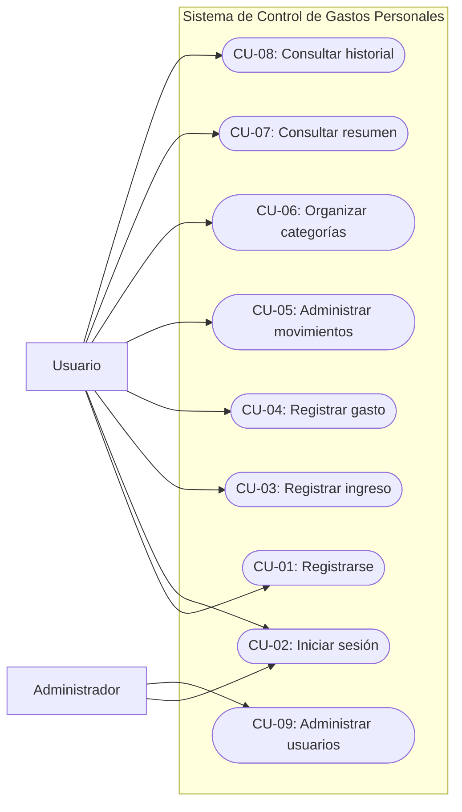
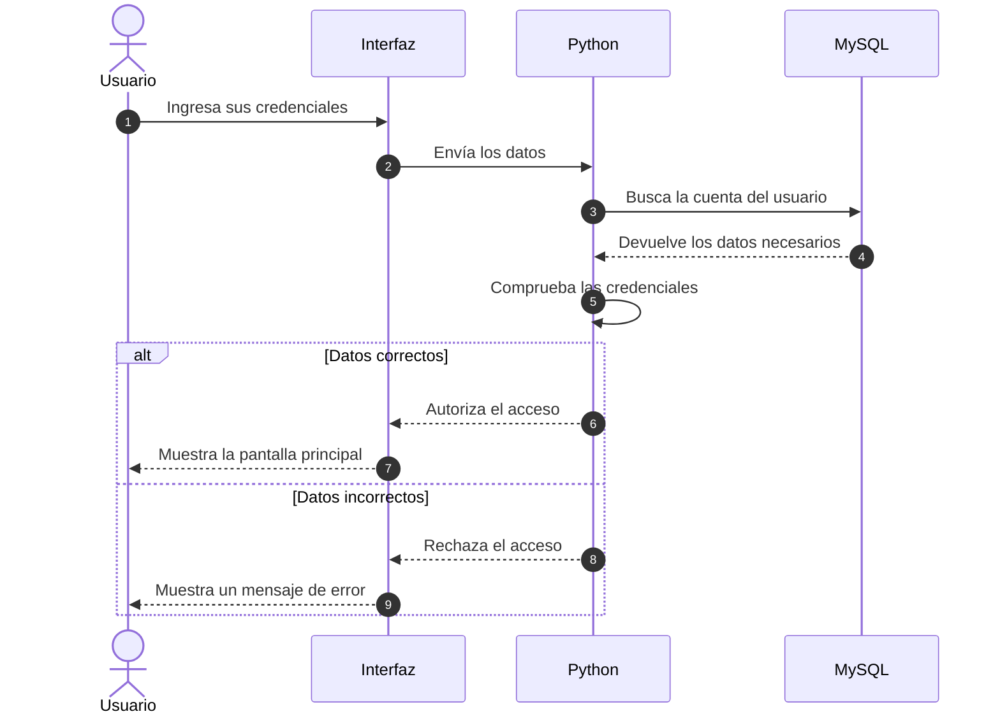
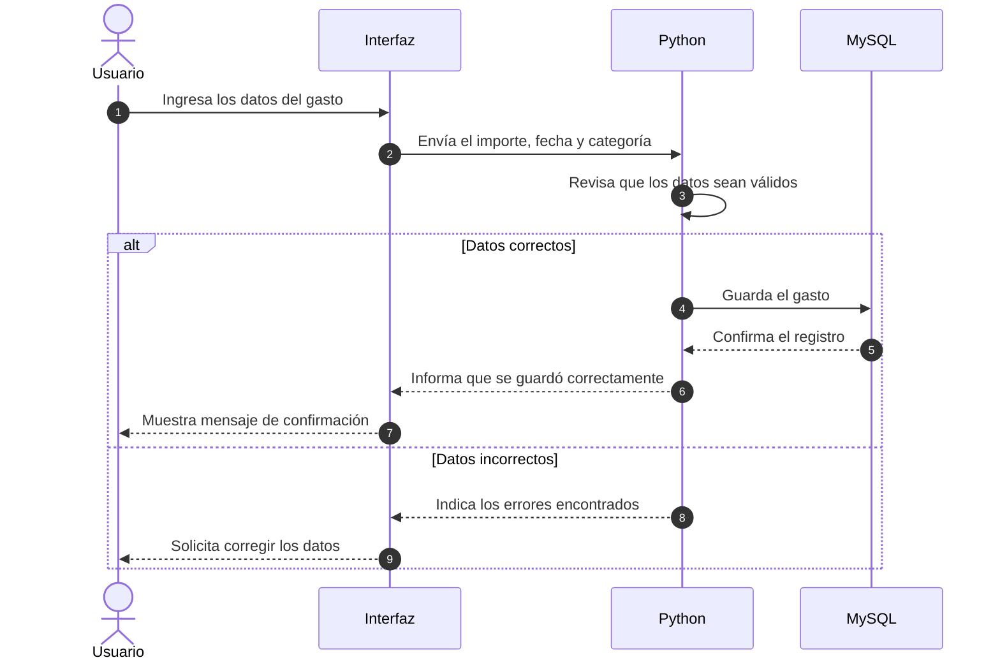
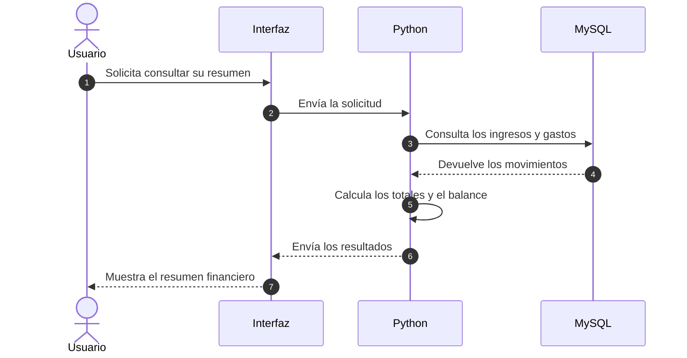

# Especificación de Requisitos de Software (SRS) - IEEE 830-1998

## 1. Introducción y Propósito

### 1.1 Propósito

El propósito de este documento es explicar qué funciones tendrá nuestro Sistema de Control de Gastos Personales y qué características debe cumplir. Esto nos ayudará a tener más claro qué vamos a desarrollar, cómo queremos que funcione y qué debemos revisar durante las pruebas.

### 1.2 Alcance del Sistema

Nuestro proyecto consiste en desarrollar un Sistema de Control de Gastos Personales que ayude a las personas a organizar mejor su dinero. La idea es que puedan registrar sus ingresos y gastos, clasificarlos por categorías y consultar cuánto dinero reciben, cuánto gastan y cuál es su balance.

Buscamos que el sistema sea fácil de usar y que permita consultar la información sin tener que llevar todos los registros manualmente. Para trabajar en el proyecto utilizaremos Python para programar las funciones y MySQL para guardar y administrar los datos.

En esta primera versión nos enfocaremos en el registro de ingresos y gastos, la organización de los movimientos y la consulta de resúmenes. Por el momento, no contemplamos funciones como la conexión directa con cuentas bancarias.

### 1.3 Usuarios del Sistema

- **Usuario:** podrá registrar sus ingresos y gastos, organizar sus movimientos y consultar su información.
- **Administrador:** si incluimos este perfil en el desarrollo, podrá realizar tareas de administración de las cuentas de usuario.

### 1.4 Definiciones

- **SRS:** documento donde se describen los requisitos del sistema.
- **RF:** requerimientos funcionales, es decir, las acciones que podrá realizar el sistema.
- **RNF:** requerimientos no funcionales, que describen características como seguridad, facilidad de uso y rendimiento.
- **UML:** herramienta que utilizamos para representar el funcionamiento del sistema mediante diagramas.
- **BD:** base de datos donde se guarda la información.

## 2. Requerimientos Funcionales (RF)

En esta sección describimos las funciones que queremos incluir en nuestro sistema.

| Código | Nombre del Requisito | Descripción | Prioridad | Actor Principal |
| :--- | :--- | :--- | :---: | :--- |
| RF-01 | Registro de usuarios | El sistema permitirá crear una cuenta para poder utilizar la aplicación. | Alta | Usuario |
| RF-02 | Inicio de sesión | El usuario podrá ingresar con sus credenciales registradas. | Alta | Usuario |
| RF-03 | Registrar ingresos | El usuario podrá registrar el dinero que recibe, incluyendo el importe, la fecha y una descripción. | Alta | Usuario |
| RF-04 | Registrar gastos | El usuario podrá guardar los gastos que realiza, indicando el importe, la fecha y una categoría. | Alta | Usuario |
| RF-05 | Administrar movimientos | El usuario podrá consultar, editar y eliminar sus ingresos y gastos registrados. | Alta | Usuario |
| RF-06 | Organizar categorías | El sistema permitirá organizar los movimientos en categorías como comida, transporte, vivienda y entretenimiento. | Media | Usuario |
| RF-07 | Consultar resumen | El usuario podrá consultar cuánto dinero ha recibido, cuánto ha gastado y cuál es su balance. | Alta | Usuario |
| RF-08 | Consultar historial | El usuario podrá revisar los movimientos que ha registrado anteriormente. | Media | Usuario |
| RF-09 | Administrar usuarios | Si se incluye un administrador, podrá gestionar las cuentas de acuerdo con los permisos que se establezcan. | Media | Administrador |

## 3. Requerimientos No Funcionales (RNF)

Además de las funciones anteriores, nuestro sistema debe cumplir con ciertas características para que sea útil, seguro y fácil de utilizar.

- **RNF-01 (Rendimiento):** Buscaremos que las consultas y operaciones más comunes se realicen en un tiempo adecuado, sin que el usuario tenga que esperar demasiado.
- **RNF-02 (Seguridad):** La información de los usuarios deberá estar protegida. Se deberán validar las credenciales y evitar que una persona pueda consultar o modificar los movimientos de otra.
- **RNF-03 (Facilidad de uso):** La aplicación deberá tener una interfaz sencilla, con opciones claras y mensajes que ayuden al usuario a saber si una operación se realizó correctamente.
- **RNF-04 (Integridad de los datos):** El sistema deberá revisar que los datos ingresados sean válidos, por ejemplo, que los importes sean correctos y que no falten los campos obligatorios.
- **RNF-05 (Mantenimiento):** Organizaremos el código para que sea más fácil encontrar errores y realizar cambios cuando sea necesario. También utilizaremos Git y GitHub para llevar un control de las modificaciones del proyecto.
- **RNF-06 (Almacenamiento):** Utilizaremos MySQL para guardar los datos y comprobar que los ingresos, gastos y demás registros se almacenen y consulten correctamente.

Estos requisitos son los objetivos que buscamos cumplir. Para comprobarlos, tendremos que realizar pruebas conforme avancemos con el desarrollo.

## 4. Diagrama de Casos de Uso y Descripción

El siguiente diagrama muestra las principales acciones que podrá realizar el usuario dentro de nuestro Sistema de Control de Gastos Personales. También se incluye el administrador como un perfil opcional, en caso de que decidamos implementarlo.

### 4.1 Descripción de los Casos de Uso

| Código | Caso de Uso | Actor | Descripción |
| :--- | :--- | :--- | :--- |
| CU-01 | Registrarse | Usuario | Permite crear una cuenta para utilizar el sistema. |
| CU-02 | Iniciar sesión | Usuario / Administrador | Permite ingresar al sistema con las credenciales correspondientes. |
| CU-03 | Registrar ingreso | Usuario | Permite guardar el dinero que recibe el usuario. |
| CU-04 | Registrar gasto | Usuario | Permite registrar el dinero que gasta el usuario. |
| CU-05 | Administrar movimientos | Usuario | Permite consultar, modificar o eliminar sus movimientos. |
| CU-06 | Organizar categorías | Usuario | Permite clasificar los ingresos y gastos para mantenerlos ordenados. |
| CU-07 | Consultar resumen | Usuario | Muestra los ingresos, gastos y balance del usuario. |
| CU-08 | Consultar historial | Usuario | Permite revisar los movimientos registrados anteriormente. |
| CU-09 | Administrar usuarios | Administrador | Permite gestionar las cuentas si se incluye este perfil. |

## 5. Diagramas de Secuencia UML

Los diagramas de secuencia nos ayudan a entender cómo se comunican las diferentes partes del sistema cuando una persona realiza una operación. A continuación, mostramos tres ejemplos de las funciones principales.

### 5.1 Inicio de Sesión

Este diagrama representa lo que sucede cuando un usuario intenta ingresar al sistema. Se revisan sus credenciales y se le permite entrar solamente si son correctas.

### 5.2 Registro de un Gasto

En este caso, el usuario ingresa los datos de un gasto y el sistema revisa que estén completos antes de guardarlos.

### 5.3 Consulta del Resumen Financiero

Este diagrama muestra cómo el sistema obtiene los ingresos y gastos guardados para calcular el balance y presentar los resultados al usuario.

## 6. Pruebas y Criterios de Aceptación

Para revisar que el sistema funcione como esperamos, realizaremos pruebas conforme se desarrollen sus funciones. Algunos de los puntos que revisaremos son:

- Que el usuario pueda registrarse e ingresar con sus credenciales correctas.
- Que el sistema muestre un mensaje cuando los datos de acceso sean incorrectos.
- Que los ingresos y gastos se guarden correctamente en MySQL.
- Que el usuario pueda consultar y modificar sus propios movimientos.
- Que los totales y el balance se calculen correctamente.
- Que el sistema avise cuando falten datos o se ingresen valores incorrectos.
- Que cada usuario solamente pueda consultar su propia información financiera.

## 7. Conclusión

Con este documento definimos las funciones que queremos desarrollar en nuestro Sistema de Control de Gastos Personales y las características que debemos tomar en cuenta para que funcione correctamente.

Los casos de uso nos ayudan a identificar las acciones que podrá realizar el usuario, mientras que los diagramas de secuencia muestran los pasos que seguirá el sistema en algunas operaciones. Esta información nos servirá como guía para continuar con el diseño y el desarrollo del proyecto utilizando Python y MySQL.
